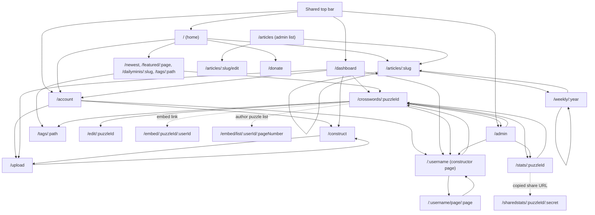

# Crosshare Page Layout

This document maps the user-facing routes implemented under `app/pages/` and
the main in-app links between them. Next.js derives each route from its file
path; bracketed segments are dynamic values, and optional catch-all segments
may be omitted.

## Page navigation diagram

The shared top bar is present on most non-embedded pages. Its admin link is
shown only to users with the admin claim. Puzzle, profile, and article
navigation is often rendered by shared components, so the arrows represent
links available wherever those components are used rather than a unique link
in every route file.

The constructor and upload pages switch into the interactive builder in place;
those editing steps do not navigate to `/edit/:puzzleId`. The `/edit` route is
the separate editor for an already-published puzzle.

Dashed arrows represent generated embed or share URLs. An embed route is
typically opened in an iframe, and shared stats are opened by anyone who has
the secret URL; neither is a normal menu destination.

## Route index

| Route | Page purpose |
| --- | --- |
| `/` | Home page; links to featured content, newest puzzles, daily minis, articles, account, and donations. |
| `/account` | Signed-in account settings; links to puzzle creation/upload and the user's constructor page when present. |
| `/admin` | Admin-only moderation, settings, and operational tools. |
| `/articles` | Admin-only article list. |
| `/articles/:slug` | Public article page; articles can link to adjacent articles and weekly archives. |
| `/articles/:slug/edit` | Admin-only article editor. |
| `/construct` | Start or resume the in-page crossword constructor. |
| `/crosswords/:puzzleId` | Puzzle play page (the route also accepts optional trailing path segments). |
| `/dashboard` | Signed-in constructor dashboard with authored puzzles and account/profile links. |
| `/dailyminis/:slug` | Daily mini and archive (optional catch-all route segments). |
| `/donate` | Donation information and donor links. |
| `/edit/:puzzleId` | Signed-in editing page for an existing puzzle. |
| `/embed/:puzzleId/:userId` | Embedded puzzle view. |
| `/embed/list/:userId/:pageNumber` | Embedded constructor puzzle list; page number is optional. |
| `/featured/:pageNumber` | Featured puzzle listing and pagination. |
| `/newest/:pageNumber` | Newest puzzle listing and pagination; page number is optional. |
| `/packs` | Packs landing page (currently marked “Coming soon”). |
| `/packs/:packId` | Pack page. |
| `/packs/:packId/authenticate` | Authenticated pack flow; on success it navigates to the pack page. |
| `/packs/:packId/edit` | Pack editing route. |
| `/packs/:packId/manage` | Pack management route. |
| `/privacy` | Privacy policy. |
| `/rebuild` | Signed-in word database rebuild utility. |
| `/sharedstats/:puzzleId/:secret` | Shared puzzle statistics, accessed with a secret URL. |
| `/stats/:puzzleId` | Signed-in puzzle statistics; links back to the puzzle and can generate a shared-stats URL. |
| `/subscription` | Subscription-management callback route, generally opened from a signed link. |
| `/tags/:path` | Tag-based puzzle listing (catch-all path supports multiple tags and pagination). |
| `/thankyou` | Thank-you page used as a standalone destination. |
| `/tos` | Terms of service. |
| `/upload` | Upload a puzzle file and continue in the in-page builder. |
| `/weekly/:year` | Weekly email/article archive by year. |
| `/:username` | Constructor profile and public puzzle list (implemented by the root catch-all page). |
| `/:username/page/:page` | Paginated constructor profile. |

The repository also contains `/icons` as a component/icon preview page and
Next.js infrastructure pages (`/404`, `/_app`, `/_document`, `/_error`); these
are not part of the normal product navigation. API handlers under
`app/pages/api/` are endpoints rather than rendered pages and are omitted from
the diagram.

## Navigation implementation references

- [Page route files](../app/pages/)
- [Shared top bar](../app/components/TopBar.tsx)
- [Puzzle links and actions](../app/components/Puzzle.tsx)
- [Puzzle overlay and embed links](../app/components/PuzzleOverlay.tsx)
- [Constructor profile navigation](../app/components/ConstructorPage.tsx)
- [Home page links](../app/pages/index.tsx)
